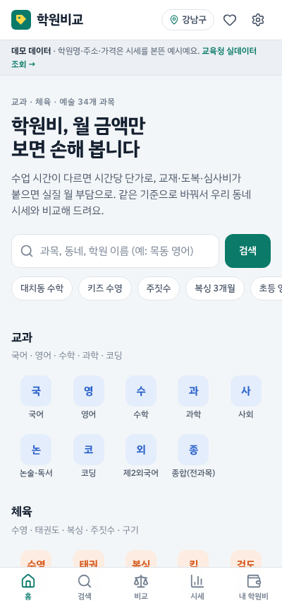
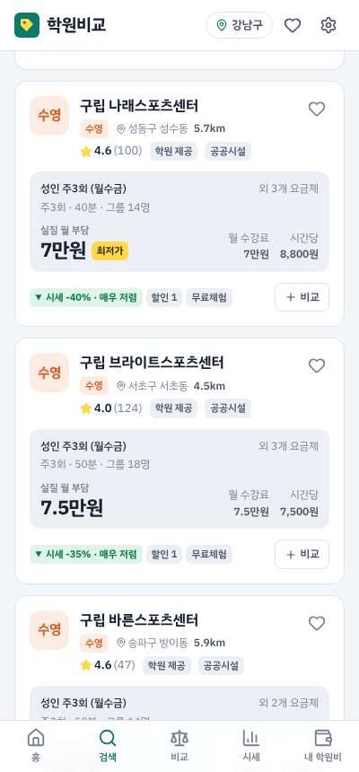
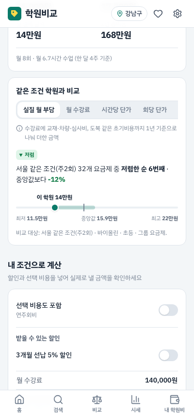
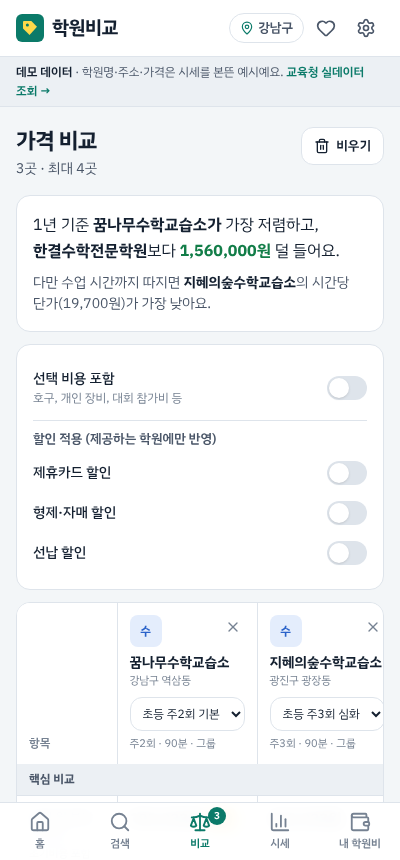
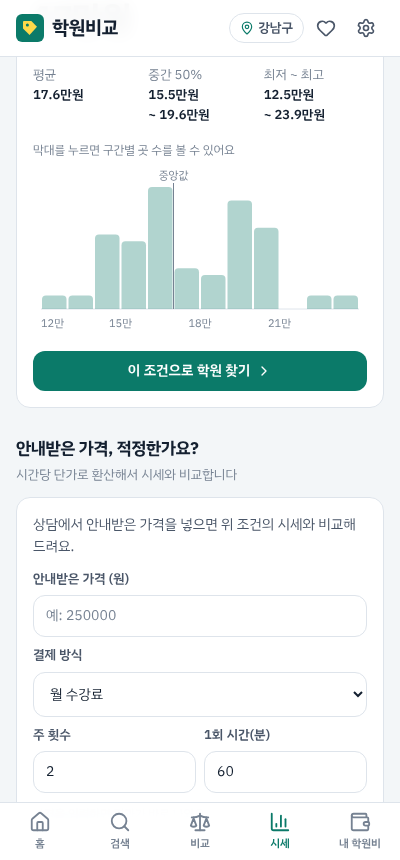

# 학원비교 · 학원 검색 & 학원비 가격비교

국어·영어·수학·과학 같은 교과 학원부터 수영·태권도·복싱·킥복싱·검도·주짓수·농구·축구·야구 같은 체육, 피아노·미술·발레·댄스 같은 예술까지 **34개 과목**의 학원을 찾고, **학원비를 공정한 기준으로 비교**하는 웹앱입니다. 모바일 우선으로 만들었고 데스크톱에서도 동작합니다.

| 홈 | 검색 | 학원 상세 | 비교 | 시세 |
| --- | --- | --- | --- | --- |
|  |  |  |  |  |

> 현재는 **시세를 본뜬 예시 데이터**(전국 44개 지역, 약 1,300개 학원)로 동작합니다. 학원명·주소·전화번호·가격은 모두 가상입니다.
> 교과·예능 학원은 앱 안의 **교육청 실데이터** 화면에서 나이스(NEIS) 공개 API로 실제 신고 교습비를 조회할 수 있습니다.

## 왜 "월 금액" 비교로는 부족한가

| 같은 "월 18만원"이라도 | 실제로는 |
| --- | --- |
| 주2회 60분 vs 주5회 60분 | 시간당 단가가 2.5배 차이 |
| 3개월권 45만원 vs 월 16만원 | 3개월권이 월 15만원이지만 첫 결제는 45만원 |
| 검도 월 15만원 | 도복·죽도·승급심사비(연 2회)·호구까지 더하면 첫해 실질 월 부담이 훨씬 큼 |
| 태권도 월 16만원 | 승급심사비 연 4회 + 도복비 + 특별활동비 |

그래서 이 앱은 모든 요금제를 같은 단위로 환산해서 비교합니다.

## 주요 기능

### 1. 검색 (`/search`)
- 과목(복수 선택)·분야(교과/체육/예술)·지역(시도/구)·내 동네 거리(1~10km)·대상(유아~성인)·수업형태(그룹/소수정예/1:1)·주당 횟수·가격 범위·차량·체험수업·할인·교육청 신고가·공공시설·평점 필터
- 검색어는 학원명·과목 키워드·동네·특징을 모두 찾음 (예: `대치동 수학`, `복싱 3개월`, `태권도 차량`)
- **비교 기준 6가지**: 실질 월 부담 / 월 수강료 / 시간당 단가 / 회당 단가 / 첫 결제 금액 / 1년 총비용
- 각 학원은 조건에 맞는 요금제 중 **선택한 기준으로 가장 싼 요금제**를 대표로 보여줌
- 결과 전체의 가격 범위(최저·중앙값·최고)와 분포 히스토그램, `최저가` 표시
- 정렬: 가격 낮은순/높은순, **시세 대비 저렴순**, 평점순, 리뷰순, 가까운순
- 검색 조건이 URL 에 저장되어 링크로 공유 가능

### 2. 학원 상세 (`/academy/:id`)
- 요금제별 안내 가격(월/기간권/횟수권/회당)과 시간당 단가
- **가격 한눈에**: 실질 월 부담, 월 수강료, 시간당·회당 단가, 첫 결제 금액, 1년 총비용
- **같은 조건 학원과 비교**: 같은 과목·연령·수업형태·주당 횟수끼리 "저렴한 순 N번째", 중앙값 대비 ±%, 시세 범위 막대
- **내 조건으로 계산**: 선택 비용(호구·장비·대회비) 포함 여부, 형제·선납·다과목·첫 달·카드 할인을 켜고 끄며 실제 낼 금액과 1년 절약액 확인
- 부대비용 상세(필수/선택, 주기, 1년 환산), 할인 혜택, 연도별 가격 변동 차트
- **같은 조건, 더 저렴한 곳** 추천 (같은 구 우선)
- 학원 정보·후기(가격 만족도 포함), **가격 제보**(이 기기에 저장, 제보 가격도 시간당으로 환산해 보여줌)

### 3. 가격 비교 (`/compare`)
- 최대 4곳을 표로 나란히, 학원마다 요금제를 바꿔가며 비교
- 핵심(실질 월 부담·시간당 단가·1년 총비용·첫 결제) / 수강료 / 부대비용 / 시세·평가 항목별로 **가장 유리한 값에 `최저`·`최고` 표시**
- 요약 문장: "1년 기준 A가 가장 저렴하고 B보다 156만원 덜 들어요. 다만 시간당 단가는 C가 가장 낮아요."
- 선택 비용·할인을 일괄 적용, 1년 비용 구성(수강료/매월 부대비용/정기 비용/초기 비용) 누적 막대 차트

### 4. 학원비 시세 (`/market`)
- 과목 × 연령 × 수업형태 × 지역으로 시세 분포(중앙값·평균·중간 50%·최저~최고 + 히스토그램)
- **안내받은 가격, 적정한가요?** 상담에서 들은 가격·결제방식·횟수를 넣으면 시간당 단가로 환산해 시세 대비 위치를 알려줌
- 구별(또는 시·도별) 시세 순위, 주당 횟수별·수업형태별 시세, 자주 붙는 부대비용과 비율
- 수영·배드민턴·탁구는 구립 공공시설을 빼고 볼 수 있음

### 5. 내 학원비 계산기 (`/budget`)
- 아이별(첫째/둘째/나…)로 학원을 담아 실질 월 부담·매달 나가는 돈·첫 달 결제·1년 총비용 합계
- 교과/체육/예술 비중, 사람별 1년 비용 구성 차트
- 앱에 없는 학원·과외도 직접 입력

### 6. 교육청 실데이터 (`/neis`)
- [나이스 교육정보 개방 포털](https://open.neis.go.kr) 학원교습소정보(`acaInsTiInfo`) API 를 브라우저에서 바로 호출
- 교육청·행정구역·분야·학원명으로 조회하고, `인당수강료내용`을 과정별 금액으로 파싱해 최저 교습비 순 정렬과 분포를 보여줌
- 인증키가 없으면 샘플 5건, 설정에서 무료 인증키를 넣으면 페이지당 100건 조회

그 밖에 찜한 학원(`/favorites`, 한 번에 비교함으로 보내기), 내 동네 설정, 기본 비교 기준, 밝게/어둡게 테마, 내 데이터 초기화(`/settings`)가 있습니다. 찜·비교함·계산기·제보·설정은 브라우저 localStorage 에 저장됩니다.

## 가격 환산 방식

`src/lib/pricing.ts` 한 곳에서 모든 환산을 합니다.

| 항목 | 계산 |
| --- | --- |
| 월 수업 횟수 | 주당 횟수 × 4주 (학원 관행: 주2회 = 월 8회) |
| 월 환산 수강료 | 월 요금 그대로 · 기간권 ÷ 개월 수 · 횟수권 (총액 ÷ 횟수) × 월 횟수 · 회당 요금 × 월 횟수 |
| 시간당 단가 | 월 환산 수강료 ÷ 월 수업 시간 |
| 회당 단가 | 월 환산 수강료 ÷ 월 수업 횟수 |
| 부대비용 | 매월(차량·재료) / 분기(교재) / 매년(보험) / 행사·심사(연 N회) / 최초 1회(등록비·도복·장비), 필수·선택 구분 |
| 첫 결제 금액 | 수강료 선결제분(기간권은 총액) + 매월 비용 + 최초 비용 + 분기·연간 비용 1회분 |
| 1년 총비용 | 월 수강료×12 + 매월 비용×12 + 정기 비용 1년분 + 최초 비용 |
| 실질 월 부담 | 1년 총비용 ÷ 12 |
| 할인 | 학원이 실제로 제공하는 할인만 적용. 선납 할인은 월납 요금제에만, 첫 달 할인은 첫 결제·1년 총액에만 반영 |

**시세 비교**(`src/lib/market.ts`)는 같은 과목·대상 연령·수업형태 요금제끼리, 같은 시·도 안에서 합니다. 월 금액 기준일 때는 주당 횟수도 같아야 같은 조건으로 보고, 표본이 5개 미만이면 전국 → 횟수 무관 순으로 넓힙니다. 백분위로 `매우 저렴 / 저렴 / 평균 / 다소 비쌈 / 비쌈`을 표시합니다.

## 실행

```bash
npm install
npm run dev          # 개발 서버 (http://localhost:5173)
npm test             # 단위 테스트 (가격 환산, 통계, 검색, NEIS 파서, 표기)
npm run typecheck    # 타입 검사
npm run build        # 정적 배포용 빌드 → dist/
npm run build:single # JS·CSS 를 HTML 하나에 넣은 데모 빌드 → dist-single/
```

`dist/` 는 해시 라우터를 쓰므로 GitHub Pages·Netlify·S3 등 어디에 올려도 새로고침이 깨지지 않습니다.

## 구조

```
src/
  types.ts               도메인 모델 (학원, 요금제, 부대비용, 할인, 제보)
  data/
    categories.ts        34개 과목 분류와 과목별 요금제 틀·부대비용 틀(시세 범위)
    regions.ts           44개 시·군·구 좌표·지역 물가 지수, 시도교육청 코드
    generator.ts         시드 고정 예시 데이터 생성기
    index.ts             데이터 접근 계층 (백엔드 연동 시 이 파일만 교체)
  lib/
    pricing.ts           가격 환산 엔진 · 비교 기준 · 가격 수준
    market.ts            시세 분포 · 같은 조건 비교 · 더 저렴한 대안
    search.ts            필터 · 대표 요금제 선택 · 정렬
    searchParams.ts      검색 조건 ↔ URL
    neis.ts              나이스 학원교습소정보 API 클라이언트 · 교습비 파서
    stats.ts, format.ts, geo.ts
  store/AppContext.tsx   찜 · 비교함 · 계산기 · 제보 · 설정 (localStorage)
  charts/                시세 범위 막대, 히스토그램, 가로 막대, 비용 구성 누적 막대, 가격 변동
  components/, pages/    화면
```

## 실서비스로 가려면

- **데이터**: 교과·예능은 NEIS 교습비를 정기 수집해 학원 단위로 저장하고 과정명을 과목·연령으로 매핑. 체육(체육도장업·수영장업 등)은 교육청 자료에 없으므로 지방행정 인허가 데이터로 시설 목록을 만들고 가격은 학원 직접 등록·영수증 인증 제보로 채우기
- **백엔드**: `src/data/index.ts` 를 API 호출로 교체 (학원/요금제/부대비용 스키마는 `types.ts` 그대로 사용 가능), 제보·리뷰는 서버 저장 + 검수
- **지도**: 카카오맵/네이버 지도 API 로 지도 보기와 실제 거리
- **앱 배포**: 지금도 홈 화면에 추가(PWA 매니페스트 포함) 가능. 스토어 배포는 Capacitor 로 감싸면 됨
